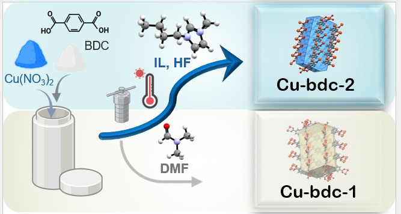

# Cu-MOF-IL
## Copper-Based Metal–Organic Frameworks: Experimental and Computational Data

# Overview

This repository contains experimental and computational data related to the structural, electronic, and gas adsorption properties of copper-based metal–organic frameworks (Cu-BDC) synthesized using different solvent systems.

# Contents

01_structures/: Crystallographic structures and CIF files.

02_experimental_data/: Experimental characterization data.

quantum-espresso/: Data related to DFT calculations for optimization and electronic properties performed using the Quantum ESPRESSO software.

GFN1/: Structural optimization data obtained using the DFTB software with the GFN1-xTB method.

orca_IL: IL optimization data using ORCA software.

04_scripts/: Scripts for data processing and analysis.

05_processed_data/: Processed data used to generate figures and tables.

# Computational methods

Periodic DFT calculations were performed using Quantum ESPRESSO and DFTB+. Details of the exchange-correlation functional, dispersion correction, Hubbard U parameters, pseudopotentials, and convergence settings are provided in the corresponding input files and project documentation.

# Data usage

Please cite the associated research article when using these data. 

Jarede S. Martins, Carolina B. P. Ligieiro, Rodrigo S. Bitzer, Yann Maia, Odivaldo C. Alves, Sara S. Vieira, Paulo Henrique M. Toledo, Gustavo F. S. Andrade, Thiago M. Rossi, Mariana M. V. M. Souza, Célia M. Ronconi, Luciano T. Costa; Ionic liquid induced structural transformation in a copper-based MOF synthesis: Experimental and DFT investigations. J. Chem. Phys. 14 June 2026; 164 (22): 224705. https://doi.org/10.1063/5.0335653

# Contact

For questions about the data, please contact: 
jarededasilvamartins.martins@gmail.com
